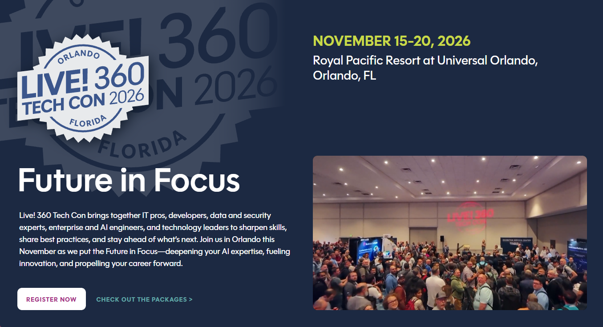

# Vectorization in Your Database: Four Demos, One Agent

Demo code for the session **Choose Wisely Between PostgreSQL, CosmosDB, SQL Server and Azure AI Search for Vectorization** at [Visual Studio Live!](https://vslive.com/ECG/live360events/Events/Orlando-2026/VSLive.aspx), part of [Live! 360 Tech Con Orlando 2026](https://live360events.com/events/orlando-2026/home.aspx).

| | |
| --- | --- |
| **Speaker** | Lino Tadros, The Training Boss |
| **Session** | [DPW02](https://live360events.com/events/orlando-2026/sessions/wednesday/dpw02-vectorization.aspx) |
| **When** | Wednesday, November 18, 2026, 8:00am - 9:15am |
| **Where** | Royal Pacific Resort at Universal Orlando, Orlando, FL |

## Why this session

Keyword search only finds the words you typed. Ask a store for "something to keep my feet dry on a rainy walk" and it finds nothing, even when it sells the perfect boot, because the product description talks about puddles and downpours instead.

Vectors let you search by meaning. Keeping them inside your database, next to the data they describe, means there's no second system to keep in sync, and a single query can combine meaning with ordinary filters such as price.

This session builds the same application four times, in three databases and in Azure AI Search, so you can compare them directly and choose the right one for your work.

## The demos

Each project is a C# console app with the same nine-step menu, the same product catalog and the same [Microsoft Agent Framework](https://github.com/microsoft/agent-framework) agent. Only the storage and search code changes.

| Project | Store | Vector support | Search |
| --- | --- | --- | --- |
| [MAF-CosmosDB-Demo](MAF-CosmosDB-Demo/README.md) | Azure Cosmos DB for NoSQL | Vector policy with a DiskANN index | `VectorDistance` |
| [MAF-Postgresql-Demo](MAF-Postgresql-Demo/README.md) | PostgreSQL 18 | `pgvector` extension with an HNSW index | `<=>` operator |
| [MAF-SQLServer-Demo](MAF-SQLServer-Demo/README.md) | SQL Server 2025 Express | Native `vector` type, exact search | `VECTOR_DISTANCE` |
| [MAF-AzureAISearch-Demo](MAF-AzureAISearch-Demo/README.md) | Azure AI Search | Vector field with an HNSW index | Vector query, plus hybrid with RRF |

Each demo walks through the same story:

1. Import JSON documents with long product descriptions.
2. Watch keyword search fail on a natural question.
3. Generate embeddings with `text-embedding-3-small` and store them with the data.
4. Compare keyword search and vector search side by side.
5. Combine vector search with a price filter.
6. Ask an agent running `gpt-6-luna` questions it answers from your data.

## Getting started

You'll need the [.NET 11 SDK](https://dotnet.microsoft.com/download) and an Azure OpenAI or Foundry resource with `text-embedding-3-small` and `gpt-6-luna` deployed.

Pick a demo, and follow its README for the database setup and settings. Then run it from the project folder:

```bash
dotnet run
```

All four projects share the same .NET user secrets, so you only need to enter your Azure OpenAI settings once. Keys are never stored in this repository.

## Versions

All four projects target .NET 11 and share the same AI stack. Only the client library for each store differs.

| Package | Version | Used by |
| --- | --- | --- |
| .NET (`net11.0`) | 11 | All projects |
| `Microsoft.Agents.AI.OpenAI` (Microsoft Agent Framework) | 1.28.0 | All projects |
| `OpenAI` | 2.15.0 | All projects |
| `Azure.Identity` | 1.21.0 | All projects |
| `Microsoft.Extensions.Configuration.UserSecrets` and `.EnvironmentVariables` | 11.0.0 | All projects |
| `Microsoft.Azure.Cosmos` | 3.64.0 | Cosmos DB |
| `Npgsql` and `Pgvector` | 10.0.3 and 0.3.2 | PostgreSQL |
| `Microsoft.Data.SqlClient` | 7.1.2 | SQL Server |
| `Azure.Search.Documents` | 12.0.0 | Azure AI Search |
